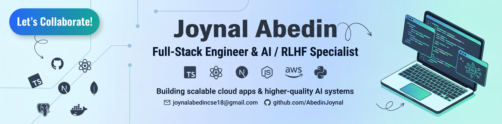

  

  <a href="https://github.com/AbedinJoynal">
    <!--  -->
  </a>

<h1 align="center">
  Hey, I’m Joynal 
</h1>

  <b>Full-Stack Software Engineer</b>  •  <b>AI Post-Training & RLHF Specialist (3+ Years @ Scale AI)</b>

  

 

    
    
    
  

 

  

 

## ⚡ About Me

I operate at the intersection of **production software engineering** and **frontier AI post-training**, pairing **3+ years at Scale AI** with end-to-end full-stack cloud development.

- 🚀 **Full-Stack Systems:** Building resilient, responsive applications with **TypeScript, React, Next.js, Node.js, and AWS**.
- 🧠 **AI & Model Quality:** Driving **LLM evaluation, SFT, RLHF / DPO**, rubric engineering, and adversarial safety testing.
- 🔄 **Engineering Synergy:** Shipping production code sharpens how I audit AI outputs—and evaluating frontier models shapes how I build AI-powered software.
- 🤝 **Open to Connect:** Reach out anytime via **[LinkedIn](https://www.linkedin.com/in/md-joynal-abedin-594b50211/)** or **[joynalabedincse18@gmail.com](mailto:joynalabedincse18@gmail.com)**.

 

 

<!-- 
 -->

<b>🔬 Explore My LLM Post-Training & Evaluation Pipeline </b>

 

    
    
    
    
  

- **Stress-Test & Execute:** Verify generated code compilation, async edge cases, multi-step reasoning, and strict schema compliance.
- **High-Signal Post-Training Data:** Author clean *Supervised Fine-Tuning (SFT)* exemplars and high-contrast *RLHF / DPO* preference rankings.
- **Safety & Reliability:** Audit hallucinations, refusal boundaries, and regressions across iterative model checkpoints.

<!-- 
 -->

  

 

<h2 align="center">
   Tech Arsenal & AI Ecosystem
</h2>

 

  

  

 

  

  

 

  

  

 

  

  

      
      
      
      
      
  

    
    
    
    
  

 

  

 

<h2 align="center">🚀 Featured Projects</h2>

 

<table>
  <tr>
    <td width="50%" align="center" valign="top">
       
      
      

        Full-stack <b>MERN e-commerce platform</b> featuring catalog search, persistent cart and checkout flows, role-based authentication, and an admin management suite.
      

      

         
        
      

    </td>
    <td width="50%" align="center" valign="top">
       
      
      

        Modern <b>hospitality & hotel booking application</b> crafted for intuitive property discovery, room comparison, and responsive reservation workflows across devices.
      

      

         
        
      

    </td>
  </tr>
</table>

 

  

 

<h2 align="center">
   GitHub Telemetry & Momentum
</h2>

 

<!-- 

  

 -->

 

     
  

 

     
  

 

  

 

  

  

  

